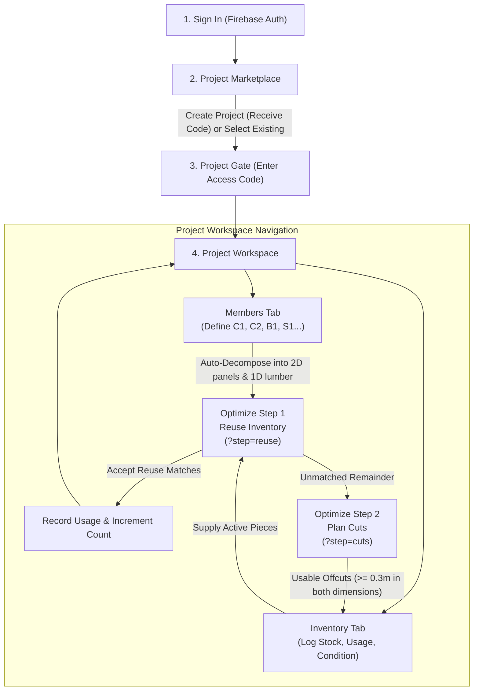

# Application User Flow & Schematic Mapping

This document describes the actual user flow of the **Formwork Cutting Optimization System** and maps each step to the project's original design specifications:
- [`schematic-diagram-flowchart.png`](../schematic-diagram-flowchart.png) (Thesis Section 3.4 Schematic Diagram)
- [`app-design-flow-specifics.png`](../app-design-flow-specifics.png) (UI Design & Flow Specifics Wireframe)

---

## 1. End-to-End User Flow Overview

---

## 2. Step-by-Step Flow Walkthrough

### Phase 1: Sign-In & Project Access Gate
1. **Authentication (`src/screens/LoginScreen.tsx`):**
   - The user signs in with email/password (or demo credentials `demo@example.com` / `demo1234`).
2. **Project Marketplace (`src/screens/ProjectsScreen.tsx`):**
   - Users browse all workspace projects with **Mine** badges.
   - **Create Project**: Generates a project and displays a 6-character Access Code (e.g., `DEMO01`) **once**. Firestore only stores a salted SHA-256 hash. After saving the code, the new project opens on **Overview**, where the checklist starts with **Start with members**.
   - **Load Demo Data**: One-click idempotent button that seeds a sample two-storey residence.
3. **Project Unlock Gate (`src/components/ProjectGate.tsx`):**
   - Entering the access code verifies the salted hash client-side and unlocks the project for the browser session.

---

### Phase 2: Structural Members & Automated Decomposition
*(Directly implements the top bar of `app-design-flow-specifics.png` and Step 2 of `schematic-diagram-flowchart.png`)*

- **Overview checklist (`src/screens/ProjectOverviewScreen.tsx`):**
  - Shows five auto-derived steps: structural members (required), lumber requirements (optional), inventory (optional), reuse decisions (required), and cut plans reviewed (required).
  - Every row links to its screen, and the project tabs show completion checks or outstanding counts.
- **Screen:** `src/screens/StructuralMembersScreen.tsx`
- **Actions:**
  - Engineers define structural components: **Columns** (`C1`, `C2`), **Beams** (`B1`, `B2`), and **Slabs** (`S1`, `S2`) with length, width, depth, and quantity.
  - Manual 1D lumber requirements (walers, braces, joists, cleats) can also be added. Each requirement may be linked to a structural member or left project-level; the lumber list shows the linked member label.
- **Under the Hood (`src/engine/decompose.ts`):**
  - The app automatically decomposes 3D structural dimensions into 2D flat contact formwork panels:
    - *Columns:* 4 rectangular phenolic side panels + lumber cleats.
    - *Beams:* 1 bottom soffit panel + 2 side panels + lumber bracing.
    - *Slabs:* Contact decking surface sheets.
  - Oversized panels exceeding standard stock (`2.44m × 1.22m`) are flagged with visual warnings.

---

### Phase 3: Digital Inventory Management & Condition Tracking
*(Directly implements the left panel of `app-design-flow-specifics.png` and steps 3–4 of `schematic-diagram-flowchart.png`)*

- **Screen:** `src/screens/ProjectInventoryScreen.tsx`
- **Features:**
  - **Material Logging:** Engineers register pieces with Material Type (Phenolic Board vs. Lumber cross-sections `2×2`, `2×3`, `2×4`), dimensions (Length, Width, Thickness), an optional label for site identification, Condition (`Good` or `For Inspection`), and Storage Location.
  - **Open a piece:** Selecting anywhere on a table row or card opens its detail; Edit stays a separate action.
  - **Usage Count & Inspection Threshold:** Tracks `usageCount`. When a piece reaches **5 uses**, the app flags it `For Inspection` (ADR-0004).
  - **Retire/Exclude:** Damaged pieces can be marked `Retired` to exclude them from the optimization algorithm.

---

### Phase 4: Step 1 — Reuse Inventory (Best-Fit Ranking)
*(Directly implements steps 5–7 of `schematic-diagram-flowchart.png`; deep link `?step=reuse`)*

- **Screen:** `src/screens/OptimizationScreen.tsx` (Optimize step: *Reuse inventory*)
- **Algorithm (`src/engine/match.ts`):**
  - Takes the decomposed requirements from Phase 2 and matches them against active pieces in inventory.
  - **Matching Criteria:** Same material type, sufficient dimensions (`piece.L >= req.L` and `piece.W >= req.W`), and non-retired condition.
  - **Ranking:** Uses a *Smallest-Fit* heuristic to prioritize pieces that fit with minimum leftover margin, preserving larger offcuts for bigger future panels.
- **Reuse allocation:** an accepted piece is treated as a small stock sheet. The shelf packer nests as many accepted panels as fit, allows 90° rotation, and records each placement plus the leftover rectangles. One `2.44m × 1.22m` piece can therefore cover several panels of the same or different requirements. A piece is never assigned twice and placements cannot overlap.
- **User Interaction:**
  - Engineers review candidates grouped by structural member and can **Accept** or **Decline**. A candidate piece already used by another panel stays available while its remaining area still fits the new panel, and the row shows a “shares piece” hint. Requirements with no available candidate or remaining space are marked **New stock** automatically. Decisions persist per project and survive reloads.
  - Accepting marks the requirement satisfied. The first accepted panel increments the piece's `usageCount` and creates a `usageLog` entry linked to that structural member (e.g. `C1`); additional panels from the same piece are added to the same entry without another usage increment.
  - Dimensions in a reuse plan are exact and include no saw kerf or blade allowance.

---

### Phase 5: Step 2 — Plan Cuts & Offcut Intake
*(Directly implements the right red box in `app-design-flow-specifics.png` and "Cutting Optimization for New Material"; deep link `?step=cuts`)*

- **Screen:** `src/screens/OptimizationScreen.tsx` (Optimize step: *Plan cuts*)
- **Segmented workspace:** Results are grouped into **Sheets**, **Lumber**, and **Offcuts** with counts. The step opens on Sheets when panels remain, otherwise Lumber, and visiting it records that cut plans were reviewed.
- **Unplaced detail:** Panels and lumber requirements larger than the configured stock are listed in an **Unplaced** section above the segments, even when no sheets can be produced. The same items feed the project notification drawer, and both link to stock settings.
- **Algorithm (`src/engine/plywood.ts` & `src/engine/lumber.ts`):**
  - Requirements not satisfied by existing inventory must be cut from new stock.
  - Uses 2D Shelf First-Fit Decreasing (ADR-0005) with strictly valid **Guillotine cuts** (ADR-0003) on standard 2.44m × 1.22m sheets.
- **Reused pieces:** accepted reuse allocations are shown above the segments as their own cut diagrams (`SheetDiagram` + `SheetNotes`), with panel placements and leftovers, alongside the new-stock sheets. The note states that dimensions are exact and no saw kerf is included.
- **Visual Cut Plan Sheet (`src/components/optimize/CutPlanSheet.tsx`):**
  - Renders interactive SVGs showing the exact layout of panels on each sheet with dimensions and member color tags.
  - Hatched regions display cutting waste and remaining usable offcuts.
  - Sheets can be exported as SVG or PNG images.
- **Offcut Intake (`src/components/optimize/OffcutIntake.tsx`):**
  - Offcuts meeting the thesis reuse threshold (≥ 0.3 m in both dimensions) are surfaced with a one-click **Add to inventory** button to feed back into inventory for future pours.
  - **Inventory CSV:** The Inventory screen exports every piece, including retired pieces and optional labels.

---

## 3. Alternative Flow: Member Planner (Preview)

- **Screen:** `src/screens/MemberFocusScreen.tsx` (sidebar: *Member planner*, separated under *Alternative flow*; route `/projects/{id}/focus`).
- **Purpose:** Compare a member-first workflow with the requirement-first Optimize flow. The user picks one structural member, sees its decomposed panels, and assigns an inventory piece to each panel before the cut plan is drawn.
- **Flow:** choose member → per-panel inventory select (or **Use best matches**) → summary (reused panels, new sheets, linked lumber, utilization, unplaced) → reused-piece diagrams with remaining space, then sheet visualization and offcut notes. Best matches are applied automatically on first load and after switching members; **Use best matches** re-runs the allocator, and manual changes stay until another member is selected.
- **Nesting:** a second panel may select a piece already used by another panel while the remaining area still fits; the planner repacks the piece and shows the resulting diagram and leftovers. Summary counts are panels covered, not pieces consumed.
- **Scope:** the selected member's plywood panels plus any lumber requirements linked to that member. A **Lumber for &lt;member&gt;** section groups linked cuts by cross-section, shows utilization, lists unplaced cuts, and notes that dimensions are exact with no saw kerf. Project-level lumber remains in the main Optimize flow; member-linked lumber is still planned there as well, since links only scope this preview. The planner is a **preview**: choices do not consume inventory, record usage, or change saved optimization decisions. Panels left unassigned are planned from new stock; those larger than the configured stock are marked **Exceeds stock** with a link to Settings. Reuse dimensions are exact and include no saw kerf.
- **Why separate:** the client can compare this flow against the optimized reuse-then-cuts flow without committing to either.

---

## 4. Diagram Comparison Matrix

| Step in `schematic-diagram-flowchart.png` | Element in `app-design-flow-specifics.png` | Corresponding Code / Screen | Status |
| :--- | :--- | :--- | :--- |
| **Create / Select Project** | Top project identifier (`P: 001`) | `src/screens/ProjectsScreen.tsx`, `src/components/ProjectGate.tsx` | **Full Match** |
| **Structural Member Dimensions** | Member bar (`C1: 1x1`, `C2: 0.8x0.8x2.4`) | `src/screens/StructuralMembersScreen.tsx` | **Full Match** |
| **Formwork Panel Decomposition** | Panel breakout (`0.3 x 2.4`) | `src/engine/decompose.ts` | **Full Match** |
| **Inspect and Record Material** | Left table (`DIM, TYPE, QTY, COND, USAGE`) | `src/screens/ProjectInventoryScreen.tsx` | **Full Match** |
| **Suitable for Reuse / Retire** | Condition filter & Retire action | `src/components/inventory/PieceDetailDialog.tsx` | **Full Match** |
| **Apply Matching Criteria & Rank** | `(C1) -> 1x1 => 003: 1x1, 007: 1.2x1` | `src/components/optimize/MatchGroups.tsx` & `src/engine/match.ts` | **Full Match** |
| **Update Digital Inventory (Usage Log)** | `1 USAGE`, `2 USAGE` arrows | `src/db/inventory.ts` (`recordUsage`) | **Full Match** |
| **Cutting Optimization for New Material** | 1.22m × 2.44m Plywood cutting layout | `src/components/optimize/CutPlanSheet.tsx` & `src/engine/plywood.ts` | **Full Match** |
| **Return Usable Offcut to Inventory** | Arrow from cutting sheet back to Inventory | `src/components/optimize/OffcutIntake.tsx` | **Full Match** |
