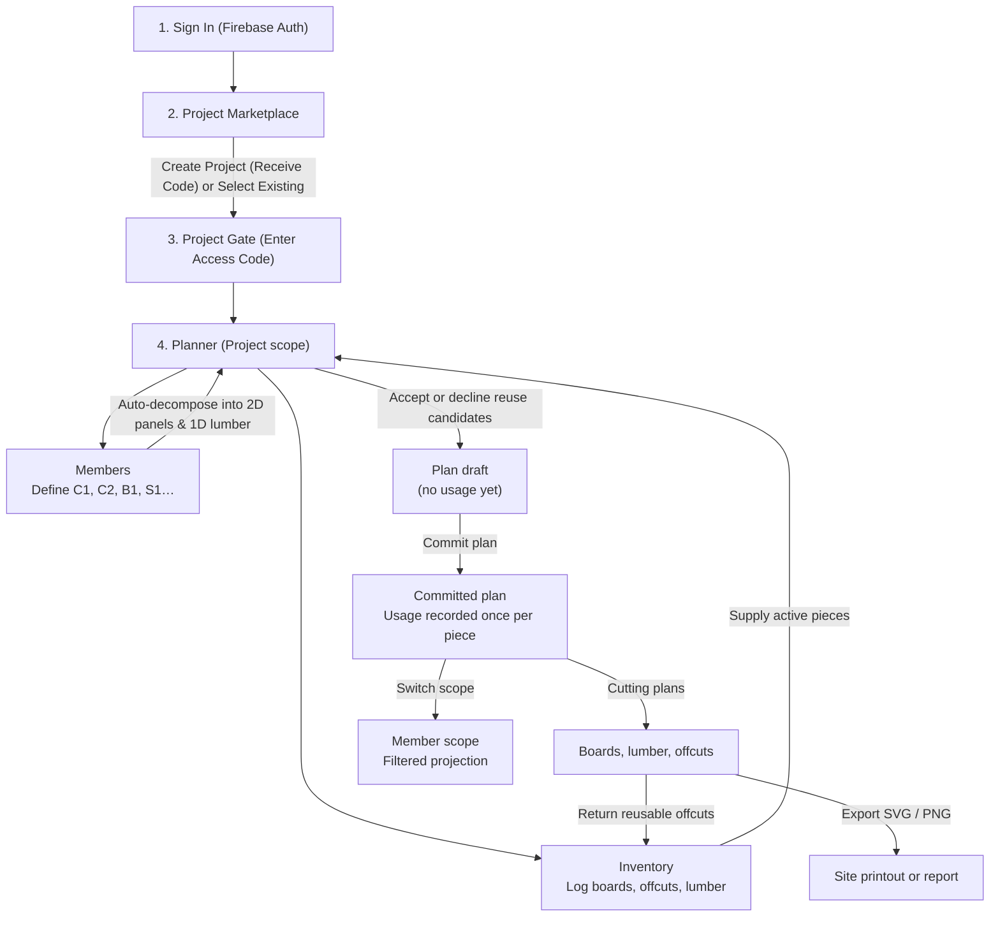

# Application User Flow & Schematic Mapping

This document describes the actual user flow of the **Formwork Cutting Optimization System** and maps each step to the project's original design specifications:
- [`schematic-diagram-flowchart.png`](../schematic-diagram-flowchart.png) (Thesis Section 3.4 Schematic Diagram)
- [`app-design-flow-specifics.png`](../app-design-flow-specifics.png) (UI Design & Flow Specifics Wireframe)

---

## 1. End-to-End User Flow

The Planner is the only optimization screen. **Project scope** is the default and the project landing route. **Member scope** is a filtered view of the same global allocation.

---

## 2. Step-by-Step Flow Walkthrough

### Phase 1: Sign-In & Project Access Gate
1. **Authentication** (`src/screens/LoginScreen.tsx`): sign in with email/password or the demo account (`demo@example.com` / `demo1234`).
2. **Project Marketplace** (`src/screens/ProjectsScreen.tsx`): browse visible projects with **Mine** badges. Creating a project generates a 6-character Access Code shown once; Firestore stores only a salted SHA-256 hash. Loading demo data seeds a sample two-storey residence.
3. **Project Unlock Gate** (`src/components/ProjectGate.tsx`): the access code is verified client-side and unlocks the project for the browser session.

### Phase 2: Structural Members & Automated Decomposition
- **Screen:** `src/screens/StructuralMembersScreen.tsx`
- Engineers define **Columns**, **Beams**, and **Slabs** with label, length, width, height, and quantity. Manual 1D lumber requirements (walers, braces, joists, cleats) may be linked to a member or left project-level.
- **Decomposition** (`src/engine/decompose.ts`): columns become 4 side panels, beams become 1 soffit + 2 side panels, slabs become 1 decking panel. Panels larger than stock are flagged with warnings.
- Member-linked lumber appears in Member scope; project-level lumber appears in Project scope.

### Phase 3: Digital Inventory Management
- **Screen:** `src/screens/ProjectInventoryScreen.tsx`
- Register phenolic boards or lumber pieces with dimensions, optional label, condition (`Good` / `For Inspection`), and storage location.
- Each physical piece has its own ID, usage count, and usage log. Reaching **5 uses** automatically sets the condition to `For Inspection`; engineers can reset it to `Good` after inspection. `Retired` pieces leave active inventory but keep their history.
- The piece detail view shows ID, label, dimensions, condition, usage count, storage location, and every usage event.

### Phase 4: Planner — Project Scope (default)
- **Screen:** `src/screens/PlannerScreen.tsx` at `/projects/{id}/planner`
- **Global allocation:** all members are decomposed and packed together against all active phenolic pieces. Member scope is not a separate packer.
- **Reuse review:** candidates are grouped by member and ranked smallest-fit-first. Rows show piece ID, label, dimensions, condition, usage count, storage location, whether cutting is required, inspection-after-this-use, and the “shares piece · remaining space fits” hint when a piece can serve another panel.
- **Shared boards:** one physical board can serve panels from several members. The board is rendered once; Member scope highlights the selected member's panels and mutes the rest.
- **Draft:** accepting or declining a candidate updates the persistent plan draft. The draft records no usage and does not change inventory. Declines are sticky per requirement and piece.
- **Commit:** when every requirement has a decision, **Commit plan** saves the project-wide plan. Each piece newly used by the plan records **one** usage event. A shared piece records every member and requirement it serves, and the piece detail reads “Used for C1, C2”.
- **Locking:** committed allocations are locked. Later packing works around them. **Release** frees one allocation explicitly; usage history is append-only and never decremented.
- **Needs Review:** a member dimension edit, piece retirement, or piece dimension change releases only the affected allocations, returns those requirements to **Needs Decision**, and marks the plan **Needs Review** with a warning naming the cause.
- **Status:** the Planner shows `Plan draft`, `Committed`, or `Needs review`.

### Phase 5: Planner — Cutting Plans, Offcuts, and Exports
- **Cutting plans:** the Planner renders every physical board as a **Cutting plan** — reused/shared boards and new-stock sheets. Each board shows placement, dimensions, member colours, waste, and reusable offcuts.
- **Unplaced items:** panels and lumber larger than the configured stock are listed so they can be split or the stock size changed in Settings.
- **Offcut return (Project scope only):** reusable offcuts (≥ 0.3 m in both dimensions) can be added to inventory as `Good` phenolic pieces with 0 uses and the project's stock thickness.
- **Exports (Project scope only):** a single board or all boards can be exported as **SVG** or **PNG**, including boards shared by multiple members.
- **Lumber:** reuse uses one requirement per lumber piece; new-stock lumber still packs multiple cuts per stock length.

### Phase 6: Planner — Member Scope
- Switch to **Member scope** in the Planner. The selected member's panels and member-linked lumber are shown; project-level lumber and procurement totals are hidden.
- Boards serving the member are shown in full with the member's panels highlighted. The member summary reports **panel coverage** (reused vs new stock vs unplaced) and the number of distinct boards serving the member.
- Reuse decisions in Member scope edit the same project draft. Candidate availability is global, so a board already used by another member is still visible with the remaining-space hint.
- **Exclusive Member Plan:** an opt-out toggle that restricts the member to unshared inventory pieces; otherwise its panels fall back to new stock. New-stock sheets may still mix members. If the member has committed shared allocations, they must be released before exclusivity can be enabled.
- Offcut return and exports remain Project-scope only.

---

## 3. Navigation and Legacy Routes

The project navigation has four items:

1. **Members**
2. **Inventory**
3. **Planner**
4. **Settings**

Planner is the landing route and the active navigation item on desktop and mobile. The notification bell and nav outstanding counts reflect the current **plan draft**.

Legacy links redirect:

| Legacy route | Destination |
| :--- | :--- |
| `/projects/{id}` | `/projects/{id}/planner` |
| `/projects/{id}/optimize` | `/projects/{id}/planner` (Project scope) |
| `/projects/{id}/focus` | `/projects/{id}/planner?scope=member` (Member scope) |
| `/projects/{id}/summary` | `/projects/{id}/planner` |

Notifications for oversized panels, oversized lumber, and plan invalidations all link to the Planner.

---

## 4. Diagram Comparison Matrix

| Step in `schematic-diagram-flowchart.png` | Element in `app-design-flow-specifics.png` | Corresponding Code / Screen | Status |
| :--- | :--- | :--- | :--- |
| **Create / Select Project** | Top project identifier (`P: 001`) | `src/screens/ProjectsScreen.tsx`, `src/components/ProjectGate.tsx` | **Full Match** |
| **Structural Member Dimensions** | Member bar (`C1: 1x1`, `C2: 0.8x0.8x2.4`) | `src/screens/StructuralMembersScreen.tsx` | **Full Match** |
| **Formwork Panel Decomposition** | Panel breakout (`0.3 x 2.4`) | `src/engine/decompose.ts` | **Full Match** |
| **Inspect and Record Material** | Left table (`DIM, TYPE, QTY, COND, USAGE`) | `src/screens/ProjectInventoryScreen.tsx` | **Full Match** |
| **Suitable for Reuse / Retire** | Condition filter & Retire action | `src/components/inventory/PieceDetailDialog.tsx` | **Full Match** |
| **Apply Matching Criteria & Rank** | `(C1) -> 1x1 => 003: 1x1, 007: 1.2x1` | `src/components/optimize/MatchGroups.tsx`, `src/engine/match.ts` | **Full Match** |
| **Update Digital Inventory (Usage Log)** | `1 USAGE`, `2 USAGE` arrows | `src/lib/planCommit.ts`, `src/db/inventory.ts` | **Full Match** |
| **Cutting Optimization for New Material** | 1.22m × 2.44m Plywood cutting layout | `src/components/optimize/CutPlanSheet.tsx`, `src/engine/plywood.ts` | **Full Match** |
| **Return Usable Offcut to Inventory** | Arrow from cutting sheet back to Inventory | `src/components/optimize/OffcutIntake.tsx` | **Full Match** |
