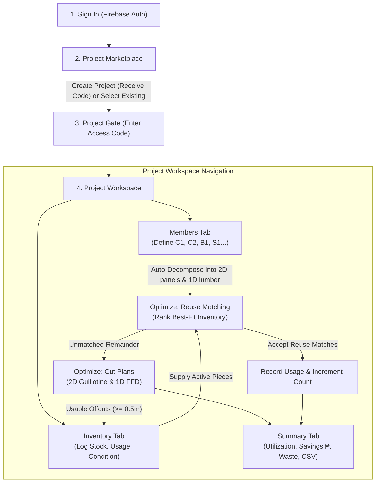

# Application User Flow & Schematic Mapping

This document describes the actual user flow of the **Formwork Cutting Optimization System** and maps each step to the project's original design specifications:
- [`schematic-diagram-flowchart.png`](../schematic-diagram-flowchart.png) (Thesis Section 3.4 Schematic Diagram)
- [`app-design-flow-specifics.png`](../app-design-flow-specifics.png) (UI Design & Flow Specifics Wireframe)

---

## 1. End-to-End User Flow Overview

---

## 2. Step-by-Step Flow Walkthrough

### Phase 1: Sign-In & Project Access Gate
1. **Authentication (`src/screens/LoginScreen.tsx`):**
   - The user signs in with email/password (or demo credentials `demo@example.com` / `demo1234`).
2. **Project Marketplace (`src/screens/ProjectsScreen.tsx`):**
   - Users browse all workspace projects with **Mine** badges.
   - **Create Project**: Generates a project and displays a 6-character Access Code (e.g., `DEMO01`) **once**. Firestore only stores a salted SHA-256 hash.
   - **Load Demo Data**: One-click idempotent button that seeds a sample two-storey residence.
3. **Project Unlock Gate (`src/components/ProjectGate.tsx`):**
   - Entering the access code verifies the salted hash client-side and unlocks the project for the browser session.

---

### Phase 2: Structural Members & Automated Decomposition
*(Directly implements the top bar of `app-design-flow-specifics.png` and Step 2 of `schematic-diagram-flowchart.png`)*

- **Screen:** `src/screens/StructuralMembersScreen.tsx`
- **Actions:**
  - Engineers define structural components: **Columns** (`C1`, `C2`), **Beams** (`B1`, `B2`), and **Slabs** (`S1`, `S2`) with length, width, depth, and quantity.
  - Manual 1D lumber requirements (walers, braces, joists, cleats) can also be added.
- **Under the Hood (`src/engine/decompose.ts`):**
  - The app automatically decomposes 3D structural dimensions into 2D flat contact formwork panels:
    - *Columns:* 4 rectangular phenolic side panels + lumber cleats.
    - *Beams:* 1 bottom soffit panel + 2 side panels + lumber bracing.
    - *Slabs:* Contact decking surface sheets.
  - Oversized panels exceeding standard stock (`2.44m × 1.22m`) are flagged with visual warnings.

---

### Phase 3: Digital Inventory Management & Condition Tracking
*(Directly implements the left panel of `app-design-flow-specifics.png` and steps 3–4 of `schematic-diagram-flowchart.png`)*

- **Screen:** `src/screens/ProjectInventoryScreen.tsx`
- **Features:**
  - **Material Logging:** Engineers register pieces with Material Type (Phenolic Board vs. Lumber cross-sections `2×2`, `2×3`, `2×4`), dimensions (Length, Width, Thickness), Condition (`Good` or `For Inspection`), and Storage Location.
  - **Usage Count & Inspection Threshold:** Tracks `usageCount`. When a piece reaches **5 uses**, the app flags it `For Inspection` (ADR-0004).
  - **Retire/Exclude:** Damaged pieces can be marked `Retired` to exclude them from the optimization algorithm.

---

### Phase 4: Reuse Matching (Best-Fit Ranking)
*(Directly implements steps 5–7 of `schematic-diagram-flowchart.png`)*

- **Screen:** `src/screens/OptimizationScreen.tsx` (Tab: *Reuse Matching*)
- **Algorithm (`src/engine/match.ts`):**
  - Takes the decomposed requirements from Phase 2 and matches them against active pieces in inventory.
  - **Matching Criteria:** Same material type, sufficient dimensions (`piece.L >= req.L` and `piece.W >= req.W`), and non-retired condition.
  - **Ranking:** Uses a *Smallest-Fit* heuristic to prioritize pieces that fit with minimum leftover margin, preserving larger offcuts for bigger future panels.
- **User Interaction:**
  - Engineers can review candidates and click **Accept** or **Decline**.
  - Accepting marks the requirement satisfied, increments the piece's `usageCount`, and records an entry in `usageLog` linked to that structural member (e.g. `C1`).

---

### Phase 5: 2D/1D Cutting Stock Optimization & Offcut Intake
*(Directly implements the right red box in `app-design-flow-specifics.png` and "Cutting Optimization for New Material")*

- **Screen:** `src/screens/OptimizationScreen.tsx` (Tab: *Cutting Plans*)
- **Algorithm (`src/engine/plywood.ts` & `src/engine/lumber.ts`):**
  - Requirements not satisfied by existing inventory must be cut from new stock.
  - Uses 2D Shelf First-Fit Decreasing (ADR-0005) with strictly valid **Guillotine cuts** (ADR-0003) on standard 2.44m × 1.22m sheets.
- **Visual Cut Plan Sheet (`src/components/optimize/CutPlanSheet.tsx`):**
  - Renders interactive SVGs showing the exact layout of panels on each sheet with dimensions and member color tags.
  - Hatched regions display cutting waste and remaining usable offcuts.
  - Sheets can be exported as SVG or PNG images.
- **Offcut Intake (`src/components/optimize/OffcutIntake.tsx`):**
  - Offcuts exceeding the thesis reuse threshold (≥ 0.5m) are surfaced with a one-click **Add to inventory** button to immediately feed back into inventory for future pours.

---

### Phase 6: System Performance & Savings Summary
*(Directly implements step 9 "Collect System and Material Performance Data" of `schematic-diagram-flowchart.png`)*

- **Screen:** `src/screens/ProjectSummaryScreen.tsx`
- **Metrics Collected (`src/engine/report.ts`):**
  - **Material Utilization %** and **Cutting Waste %** (weighted by cost between phenolic board and lumber).
  - **Total Reused Pieces & Reuse Events**.
  - **Procurement Order:** Exact number of new phenolic sheets and stock lumber pieces to purchase.
  - **Financial Savings in PHP (₱):** Cost of buying all-new stock minus the actual procurement cost achieved through reuse.
  - **CSV Export:** One-click download of all inventory, procurement lists, and cutting specifications.

---

## 3. Diagram Comparison Matrix

| Step in `schematic-diagram-flowchart.png` | Element in `app-design-flow-specifics.png` | Corresponding Code / Screen | Status |
| :--- | :--- | :--- | :--- |
| **Create / Select Project** | Top project identifier (`P: 001`) | `src/screens/ProjectsScreen.tsx`, `src/components/ProjectGate.tsx` | **Full Match** |
| **Structural Member Dimensions** | Member bar (`C1: 1x1`, `C2: 0.8x0.8x2.4`) | `src/screens/StructuralMembersScreen.tsx` | **Full Match** |
| **Formwork Panel Decomposition** | Panel breakout (`0.3 x 2.4`) | `src/engine/decompose.ts` | **Full Match** |
| **Inspect and Record Material** | Left table (`DIM, TYPE, QTY, COND, USAGE`) | `src/screens/ProjectInventoryScreen.tsx` | **Full Match** |
| **Suitable for Reuse / Retire** | Condition filter & Retire action | `src/components/inventory/PieceDetailDialog.tsx` | **Full Match** |
| **Apply Matching Criteria & Rank** | `(C1) -> 1x1 => 003: 1x1, 007: 1.2x1` | `src/components/optimize/MatchGroups.tsx` & `src/engine/match.ts` | **Full Match** |
| **Update Digital Inventory (Usage Log)** | `1 USAGE`, `2 USAGE` arrows | `src/db/inventory.ts` (`recordUsage`) | **Full Match** |
| **Cutting Optimization for New Material** | 1.22m × 2.44m Plywood cutting layout | `src/components/optimize/CutPlanSheet.tsx` & `src/engine/plywood.ts` | **Full Match** |
| **Return Usable Offcut to Inventory** | Arrow from cutting sheet back to Inventory | `src/components/optimize/OffcutIntake.tsx` | **Full Match** |
| **Collect Performance Data** | Summary metrics & Savings | `src/screens/ProjectSummaryScreen.tsx` | **Full Match** |
